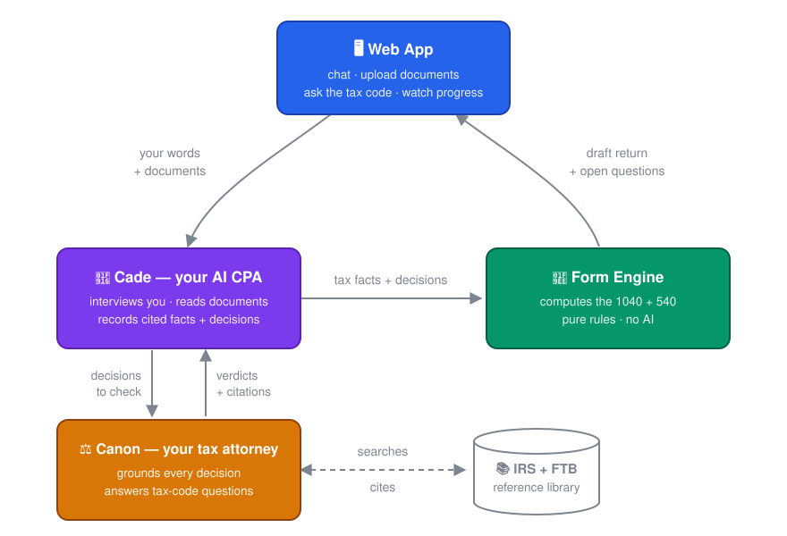
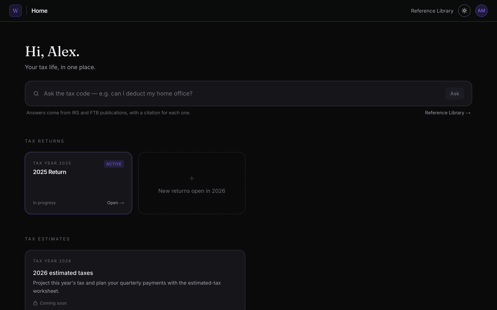
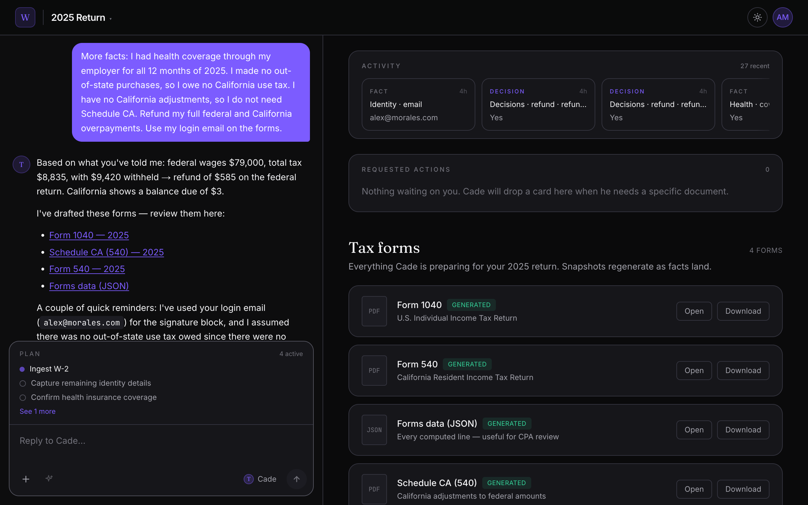
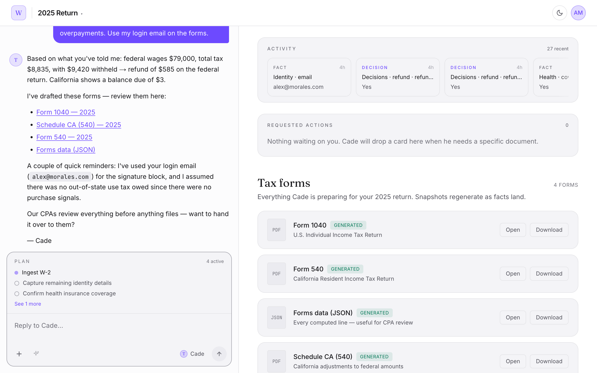
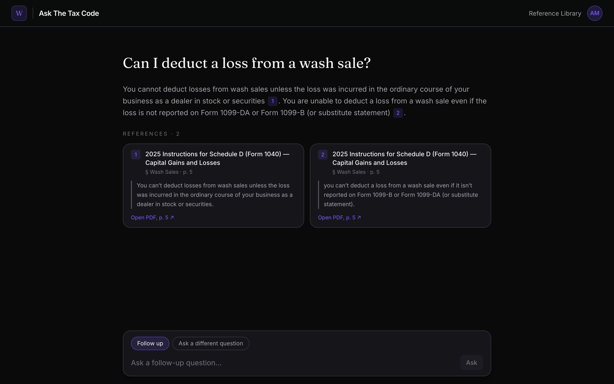
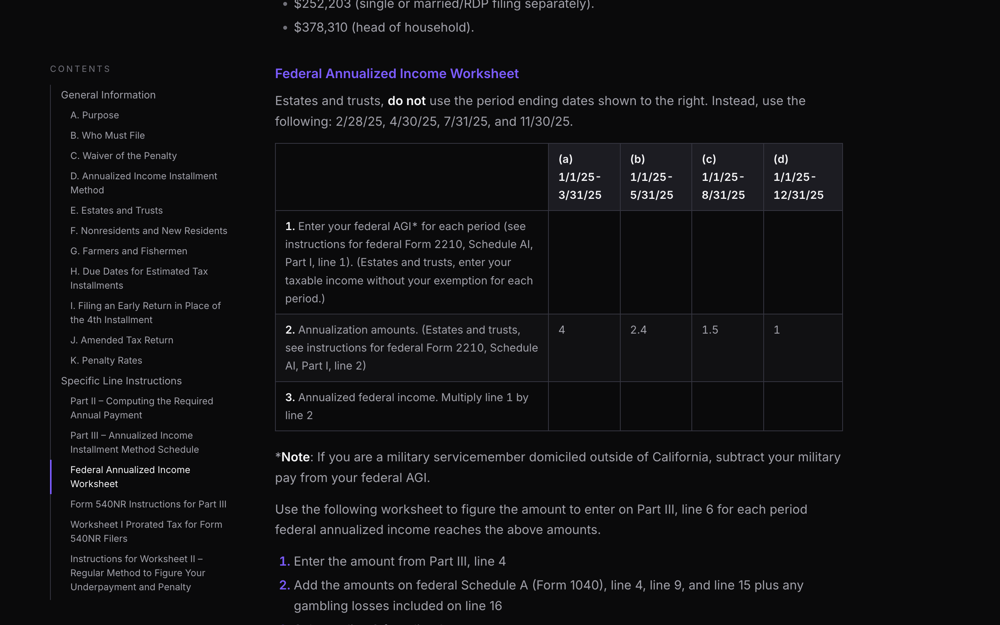

# OpenReturn by @captaincole — AI Can Do Your Taxes

OpenReturn is a local-capable AI harness that allows you to build all the documents you need to either estimate or file your taxes.

## Why? - Let's Break The System...

Taxes shouldn't be as hard as they are today. An entire industry profits from keeping the U.S. tax system difficult and opaque, but it doesn't have to be that way and this project is an attempt to change that system. 

You shouldn't have to pay a private company to help you figure out how much money you have to pay to the government!

This project was going to be a startup, but life changed directions. Now I want this to be a collaborative project that has the greatest impact it can.

## Contents

- [What Is OpenReturn?](#what-is-openreturn)
- [Before you use this — read honestly](#before-you-use-this--read-honestly)
- [Quick Start](#quick-start)
- [Documentation](#documentation)
- [License](#license)

## What Is OpenReturn?

OpenReturn is a local-capable AI harness that allows you to build all the documents you need to either estimate or file your taxes. Twin agents do the work: Cade, your CPA, and Canon, your tax attorney. OpenReturn is built with three distinct parts working together: a web app you talk to, the agents that turn the conversation into cited data, and a deterministic engine that turns the data into your return.

<p align="center">
  
</p>

- **Web App (apps/web)** — where you live: type messages, store documents, watch your
  return take shape. This is your standard web application
- **Cade (apps/agent)** — the agent: interviews you, and reads the documents you upload
  (a W-2 PDF, a 1099, a photo of either) directly. From both it does two
  critical jobs. It records **tax facts**: verbatim pieces of data, each with
  a citation for where it came from (a document, a statement line, or "you
  told me, on this date").
  And it makes **decisions**: judgment calls where the facts are ambiguous.
  Numbers are never invented — an unknown becomes an open question,
  not a guess.
- **Canon (canon)** — Cade's twin, the tax
  attorney. Every decision Cade makes is checked in the background against the
  actual IRS/FTB instruction text; Canon either cites the supporting passage
  or reopens the question. Canon also answers tax-code questions with
  citations ("Ask The Tax Code").
- **Form Engine (packages/engine)** — a solver. Takes the facts and decisions and computes the
  draft 1040/540 by the tax rules — deterministic code, no AI anywhere in the
  math. Every new fact re-computes the return, so your draft updates live as
  you talk, and the open questions it surfaces are what Cade asks you next.

### What it looks like

The home page: your returns, estimates, and tax code search.



A 2025 return: chat with Cade on the left; activity, requested actions, and the generated forms on the right.



The same page in the light theme. OpenReturn follows your system setting; the sun/moon button in the top bar switches it.



Ask The Tax Code: a question from the home page gets a short answer with numbered citations into the IRS and FTB instructions; each card quotes the passage and opens the source PDF on its page.



The Reference Library: an FTB instructions page, stored as cleaned HTML and shown in the app's reading style. A citation opens it at the cited section.



## Before you use this — read honestly

- **Your tax data goes to your model.** Every conversation turn and every background check sends your tax facts to the model you configured. A local model or your own private infrastructure keeps the data with you; a cloud API (Anthropic, OpenAI) does not.
- **This is not tax advice.** OpenReturn is in beta and produces *drafts*. Have a CPA check the work.
- **Coverage is narrow** — see [what OpenReturn supports](docs/testing-with-your-return.md#what-openreturn-supports). Outside it, Cade says "we don't handle that yet" rather than guess.

## Quick Start

The default setup uses Anthropic models (just for ease of startup), but OpenReturn can run against **any OpenAI-compatible model server**. I've personally tested this using Ollama + Gemma4 on my MacBook Air M4. Semantic retrieval (RAG) over the IRS corpus runs **locally via Ollama** with EmbeddingGemma 2 — no API key, no cost.

| Variable | Required | What it does |
| --- | --- | --- |
| `CADE_MODEL` | **Yes** (Cade's env file) | The conversation agent — must handle images (reads your W-2s). There is no in-code default: the app refuses to start without it. |
| `JUDGE_MODEL` | **Yes** (Canon's env file) | The grounding and tax-code judges that double-check AI decisions and answer questions. Also required at startup. |
| `ANTHROPIC_API_KEY` | With Anthropic models | Powers the two roles above when they point at Anthropic; set it in both env files. |
| `CADE_MODEL_URL` / `JUDGE_MODEL_URL` | For local models | Point a role at an OpenAI-compatible server instead, e.g. `CADE_MODEL=ollama/gemma4:26b` + `CADE_MODEL_URL=http://localhost:11434/v1`. |
| `CANON_URL` | No (defaults to `http://127.0.0.1:4112`) | Where Cade reaches Canon over MCP. |
| `EMBEDDINGS_MODEL` | No (defaults to `ollama/embeddinggemma-2`) | The local embedding model for semantic corpus search. Needs [Ollama](https://ollama.com) running with the model pulled; without it, search falls back to keyword matching. |
| `AGENT_API_TOKEN` | No | Gates the agent port if it's ever reachable beyond localhost. |

Local-model notes: vision, tool calling, and structured output all matter —
I've verified the full flow (document reading included) on `gemma4` via
Ollama. PDFs are rasterized to images automatically for models without
native PDF input. Expect turns to take minutes, not seconds, on laptop
hardware, and each model call must currently finish within 5 minutes.

You don't have to write this file from scratch: the first-run bootstrap
generates `apps/agent/.env.development` with `CADE_MODEL` pre-filled to an
Anthropic model (`anthropic/claude-sonnet-4-6`) and working values for
ports and `.data` paths, plus `canon/.env.development` for Canon
(`JUDGE_MODEL=anthropic/claude-haiku-5-5` and the corpus path). **The one thing it cannot
fill in is your `ANTHROPIC_API_KEY`** — set that yourself (or repoint the
model roles at a local server) before the app will do anything useful.

```bash
npm run install:all
npm run dev:all          # first run generates .env.development files
# → set ANTHROPIC_API_KEY in apps/agent/.env.development and canon/.env.development, restart
npm run corpus -- fetch  # prebuilt IRS/FTB reference corpus

# Optional but recommended — needs Ollama installed (https://ollama.com):
ollama pull embeddinggemma-2          # local embedding model for RAG
```

The last step enables semantic (RAG) search over the IRS corpus and
requires [Ollama](https://ollama.com) (`brew install ollama`, or the
installer from their site). It's optional: without it the agent still
works, and reference search falls back to keyword matching — see
[Semantic search](docs/contributing.md#semantic-search-rag-vs-keyword-fallback).

To check your setup at any point, run the doctor. It prints machine
info, resolved config, data-file state, and whether Ollama / LM Studio
are installed, running, and serving the models OpenReturn expects:

```bash
npm run doctor
```

Open http://localhost:3000 — first run redirects to `/setup` to create your
owner account.

## Documentation

| Page | For |
| --- | --- |
| [Contributing and developer guide](docs/contributing.md) | Who can contribute, and how the agent, corpus, scenarios, and form engine work |
| [Test OpenReturn against your filed return](docs/testing-with-your-return.md) | Check the engine against a return you already filed, privately, and send us the result |
| [Add a scenario](docs/adding-a-scenario.md) | The steps to add a new test taxpayer, with new forms or documents, and the tests that check each step |
| [Model evals](docs/evals/README.md) | One score per model, broken down by flow: document ingest ([full](docs/evals/ingest.md), [quick](docs/evals/ingest-quick.md)), [review judges](docs/evals/review.md) and [Ask The Tax Code](docs/evals/ask.md). Latest results, regenerated by `apps/agent/evals` |

## License

AGPL-3.0 — see [`LICENSE`](LICENSE).
