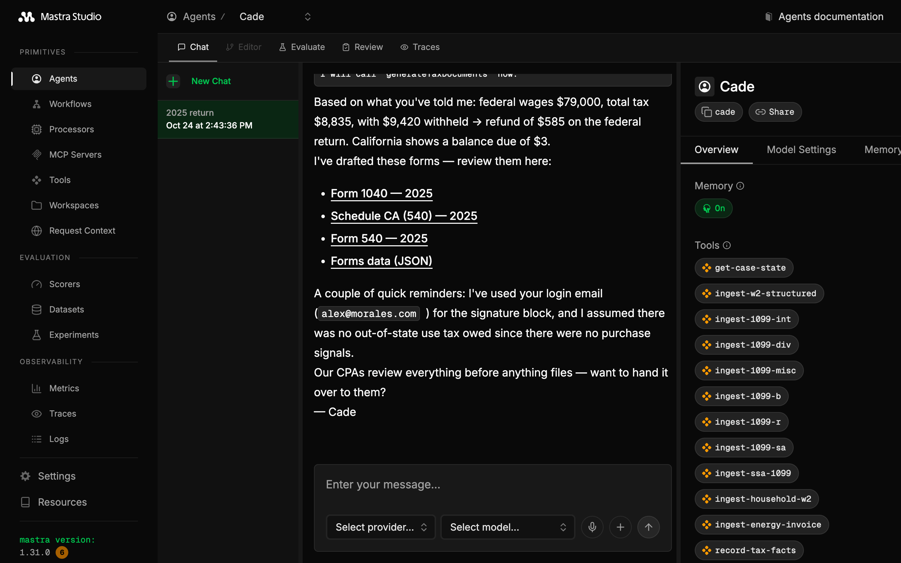

# Cade — your AI CPA

[← Back to the README](../README.md)

Cade (`@openreturn/cade`) is OpenReturn's conversational agent. It interviews you, reads your tax documents, and turns both into **tax facts** and **decisions**. The form engine computes your return from them, and Cade asks for what the engine still needs. Cade is a [Mastra](https://mastra.ai) project on port 4111.

<p align="center">
  
  <br/><em>Cade in Mastra Studio (http://localhost:4111): its threads, its tools and every trace.</em>
</p>

## What Cade does

- **Interviews you**, one step at a time. The form engine decides what to ask next; Cade does not guess the scope.
- **Reads your documents.** W-2s, 1099s and photos of them go to the model directly. Structured ingest tools (`ingest-w2-structured`, `ingest-1099-b`, …) store each value.
- **Records tax facts**, each with a citation: a document, a statement line, or "you told me, on this date". An unknown becomes an open question, never a guess.
- **Makes decisions** where the facts leave a judgment call, such as filing status or California residency. Each decision has a rationale, its supporting facts, a confidence and what could make it wrong.
- **Has each decision grounded.** `record-ai-decision` returns at once, and the review-decision workflow sends the decision to Canon's `ground` workflow over MCP. The verdict and citations come back to `app.db`.
- **Generates the forms.** `generate-tax-documents` runs the form engine and writes the filled PDFs and a JSON of every line.
- **Answers tax-code questions** through Canon. The `askTurn` workflow keeps your threads in `app.db` and asks Canon's `ask` workflow for each answer.

In the web app, Cade's chat sits next to the activity feed and the forms it drafts:

<p align="center">
  
</p>

## Run it

From the repo root:

```bash
npm run dev:all      # Canon + Cade + the web app
npm run dev          # Cade only, with Mastra Studio at http://localhost:4111
```

Cade needs Canon (`npm run dev:canon`) to ground decisions and answer questions. When Canon is down, Cade still works: a decision waits as `review_unreached`, and the next decision retries it.

## Configuration

`cade/.env.development` is written on the first run. `.env.example` lists every setting, and a gitignored `.env` overrides it.

| Setting | What it does |
| --- | --- |
| `CADE_MODEL` | **Required.** The model, as `provider/model`. It must read images and call tools. |
| `ANTHROPIC_API_KEY` | For Anthropic models |
| `CADE_MODEL_URL` | An OpenAI-compatible server (Ollama, LM Studio, vLLM) for the model |
| `CANON_URL` | Where Canon is (default `http://127.0.0.1:4112`) |
| `CANON_TIMEOUT_MS` | The cap on one call to Canon (default 5 minutes) |
| `DECISION_REVIEW` | `off` skips grounding; the verdict stays `pending` |
| `APP_DB_PATH`, `MASTRA_DB_PATH`, `DOCUMENTS_PATH` | Your data files |
| `AGENT_API_TOKEN` | Gates the port when it is reachable beyond localhost |

## Inside

```
cade/
├── src/mastra/
│   ├── agents/       Cade: instructions, working memory, PDF-to-image for models without PDF input
│   ├── tools/        ingest tools, record-tax-facts, record-ai-decision, case state, generate-tax-documents
│   ├── workflows/    reviewDecision (grounding through Canon), askTurn (Ask The Tax Code threads)
│   ├── canon/        client.ts: the MCP client, Cade's only path to Canon
│   ├── db/           app.db: facts, decisions, filings, Ask threads, review runs; the document store
│   ├── server/       /app routes, the owner middleware, storage, the console logger
│   └── loadScenario.ts   the one place app.db meets the form engine
├── scripts/          doctor, smokeReview, inspectLastReview, syncSources
├── evals/ingest/     the document-ingest eval (report in docs/evals/ingest.md)
└── tests/            unit and integration tests (tests/README.md)
```

Your data stays in `cade/.data/`: `app.db` (facts, decisions, filings), `mastra.db` (conversation memory) and `documents/`.

## Scripts

| Command (repo root) | What it does |
| --- | --- |
| `npm run doctor` | Checks the machine, the configuration, the data files and the local model servers |
| `npm run smoke:review` | Three grounding reviews end to end, on a temporary database (needs Canon) |
| `npm run reset` | Deletes your data (and Canon's run history); keeps the reference library |
| `npm run test:unit`, `npm run test:integration` | The tests, with the engine's and Canon's |

## Boundaries

- Cade reaches Canon only over MCP. `tests/unit/boundary.test.ts` fails if Cade imports Canon's code or opens `corpus.db`.
- Cade uses the form engine only through `@openreturn/engine`'s exports.
- The browser never calls Cade directly. The web app forwards each call through its session-checked `/api/agent` proxy.
