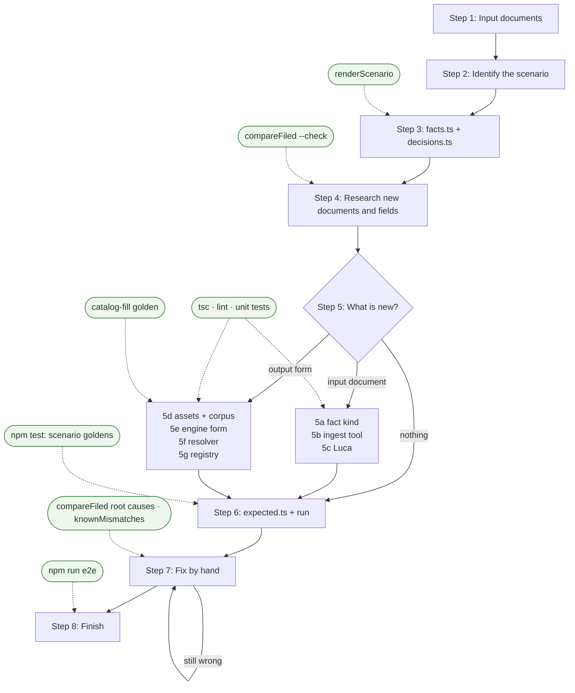

# Add a scenario

[← Back to the README](../README.md)

A scenario is one fake taxpayer. It holds their documents as facts,
their choices as decisions, and the expected value of every line on
their return. `npm test` runs the engine on it and checks each line.
Every form, document, and field we support needs a scenario that uses
it.

**All scenario data is fake.** A real return never enters the repo. To
check the engine against a real return, use the private comparison kit
([Test Summa against your filed return](testing-with-your-return.md)),
which keeps the data outside the project.

## The steps

### 1. Upload or create the input documents

Collect the W-2s and 1099s the taxpayer would hand to a preparer. Make
them fake: invented names, employers, payers, and amounts. Put one PDF
per document in `packages/engine/tests/scenarios/<name>/docs/`. For an
example generator, see `tests/scenarios/marcus/generate-docs.ts`.

Every document value in `facts.ts` must come from one of these files. If
your source gives only an amount (an SSA-1099 or a 1099-DIV, for
example), make that document yourself. Use the official form layout
where possible. Do not combine documents: a source with many pages
becomes one file per document.

### 2. Identify the scenario

Decide what the return looks like: filing status, state, which forms
it files, and which answers (decisions) it needs. Compare that with
[What Summa supports](testing-with-your-return.md#what-summa-supports).
A scenario earns its place when it covers a shape no other scenario
covers (alex: one W-2; alejandro: investment income; marcus: capital
gains; jordan: high income, HSA, rollovers, crypto; carter: MFS,
Social Security, 1099-Rs; tara: household employee, home energy credit).

### 3. Create `facts.ts` and `decisions.ts`

Create `tests/scenarios/<name>/` (copy `alex/`):

- `facts.ts` — one fact per document value, with a source note.
- `decisions.ts` — filing status and the scope answers (must-file,
  residency, …). The engine cannot run without them.
- `index.ts` — the scenario bundle and its forms in dependency order.

Add the scenario to `SCENARIOS` in `tests/scenarios/index.ts`. If a document or value has
no fact shape yet, note it for step 5.

You can now render the forms before any expected values exist:
`npx tsx scripts/renderScenario.ts --scenario=<name>` (from `apps/agent/`).

### 4. Research the new documents and fields

Find what the engine does not cover yet:

- **New input documents** (a 1099-R, for example), or new boxes on a
  document we already read.
- **New output forms** (Form 8889, for example), or new lines on a form
  we already fill.

For each one, read the IRS or FTB instructions: which lines it fills,
what it reads, and when it must be filed. The comparison kit's
`--check` lists inputs the engine does not read and forms it does not
model.

### 5. Add the new documents and fields

**A new input document:**

- **5a. Fact kind.** The row shape and key rules, in
  `packages/engine/src/facts/kinds/`, exported from `facts/index.ts`.
- **5b. Ingest tool.** A typed tool in `src/mastra/tools/` (see
  `ingest1099R.ts`) that writes the facts.
- **5c. Luca.** Register the tool in `agents/luca.ts`. Tell Luca when to
  call it in `luca.instructions.ts`.

**A new output form** (full checklist:
[Adding a form](../packages/engine/README.md#adding-a-form)):

- **5d. Assets.** `blank.pdf` and `instructions.meta.json` (with the
  instructions PDF's `sourceUrl` and `sha256`; the PDF itself is not
  committed) in `packages/sources/<year>/forms/<jurisdiction>/<short>/`.
  Then generate the catalog (it lands next to the bindings) and sync the
  corpus: `npm run form-engine -- generate-catalog`, `npm run corpus -- sync`.
- **5e. Engine form.** `types.ts`, `filingInfo.ts`, and `bindings.ts` in
  `packages/engine/src/<jurisdiction>/<short>/`. Draft the bindings with
  `npm run form-engine -- generate-bindings`, then finish them by hand.
  All money math goes through `packages/engine/src/money.ts`.
- **5f. Resolver.** Write the must-file rule, and list each answer the
  form reads in `missingInputs`, so Luca asks for it.
- **5g. Registry.** Add a `makeFormSpec` entry to the jurisdiction's
  `index.ts`. Then make the form's catalog-fill golden:
  `npx tsx tests/golden/catalogFill.ts --form-id=<id> --update`, and look at the
  PDF it writes.

**A new field on an existing document or form:** add it to the fact
kind and the ingest tool schema (5a–5b), then to the binding that reads
it (5e).

### 6. Create `expected.ts` and run the scenario

The expected values come from one of three sources:

- **A CPA return** of the fake taxpayer. Type each filled line, in
  whole dollars as printed.
- **A real filed return with the same shape.** Run the comparison kit on
  it, privately, until every line matches. Then lock the engine's output
  for the fake taxpayer: `npx tsx scripts/lockScenario.ts --scenario=<name>`.
- **No verified source yet** (a roadmap scenario). Set
  `allowNotModeled: true`. Each line the engine gets wrong goes in
  `knownMismatches.ts` with its cause.

Then run `npm test -- <name>`.

**Output goldens.** Every scenario commits one golden PDF per output
form in `docs/`, and `index.ts` points `goldenPdfPath` at it. The tests
diff every widget, so they also catch text and checkbox changes that
`expected.ts` does not list. A CPA scenario uses the CPA's filled PDFs.
A locked scenario writes its own:
`npx tsx scripts/renderScenario.ts --scenario=<name> --golden`, then
`goldenPdfPath: lockedGoldenPath("<name>", formId)`.

### 7. Fix the issues by hand

- Render the forms (`renderScenario`) and compare them with the source
  return.
- Fix the first wrong line first. One root line often moves dozens of
  lines after it. The comparison kit's report lists these root causes.
- A difference that is a preparer's style, not a rule (how they round,
  for example), goes in `preparer.rounding` in `index.ts`. The engine
  keeps the IRS rule as the default.
- A line you cannot fix now goes in `knownMismatches.ts`. When it starts
  to match, the test fails until you remove it, so the list only
  shrinks.
- After the output is verified, lock it again with `lockScenario`, and
  write the goldens again with `renderScenario --golden`.

### 8. Finish

- Run the gates in the table below. All of them must pass.
- Add new input documents to
  [What Summa supports](testing-with-your-return.md#what-summa-supports)
  and to the comparison kit's support check
  (`scripts/compareFiled/support.ts`).
- Add the scenario to the list in `apps/agent/tests/README.md`.

## The flow and its tests

Boxes are steps. Rounded boxes are the tests that check them.

## The testing touch points

| Test | Command | What it catches |
| --- | --- | --- |
| Render | `npx tsx scripts/renderScenario.ts --scenario=<name>` | Lines you can see are wrong on the PDF |
| Support check | `npx tsx scripts/compareFiled/cli.ts <folder> --check` | Inputs the engine does not read, forms it does not model |
| Type check | `npx tsc --noEmit -p apps/agent` | A field with no `category` or `valueType`, catalog drift |
| Lint | `npx eslint apps/agent/src` | Money math outside `money.ts`, oversize files and functions |
| Unit tests | `npm run test:unit` | A rule or worksheet that computes wrong, an engine boundary break |
| Integration tests | `npm run test:integration` | A form answer Luca is never told to ask (`requiredInputs`), a result that depends on form order (`formOrder`) |
| Catalog-fill | `npm test -- catalog-fill` | A widget that maps to the wrong PDF field |
| Scenario goldens | `npm test -- <name>` | A changed line value, a changed PDF fill |
| Comparison kit | `npx tsx scripts/compareFiled/cli.ts <folder>` | Lines that differ from a filed return, and their root causes |
| E2E | `npm run e2e` | A broken app, ingest tool, or document generation. Covers Alex only today. |

`npm test` runs before every commit. Run the E2E test after a change to
the web app, the agent tools, or document generation.
