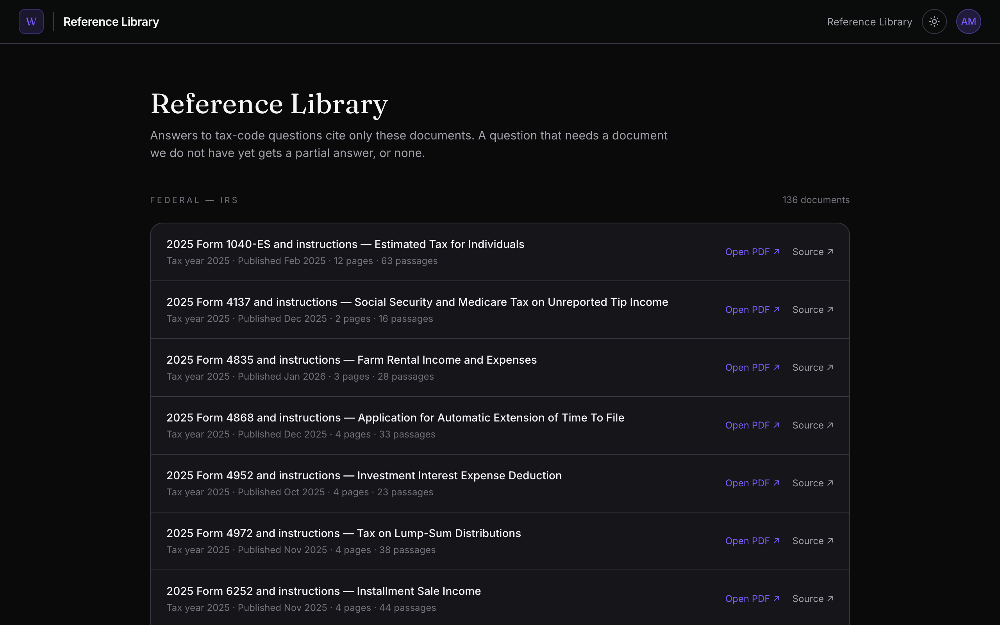

# web — the OpenReturn app

[← Back to the README](../README.md)

The web app is where you work: chat with Cade, upload documents, watch your return take shape, and ask the tax code questions. It is a Next.js 16 app (App Router) on port 3000.

<p align="center">
  
</p>

## Run

From the repo root:

```bash
npm run dev:all   # Canon (:4112) + Cade (:4111) + web (:3000)
npm run dev:web   # web only
npm run e2e       # Playwright E2E through the UI (see e2e/README.md)
```

The first run redirects to `/setup` to create the owner account. The env file is `.env.development` (see `.env.example`). `APP_DB_PATH` and `DOCUMENTS_PATH` must point at the same files as Cade's.

## Pages

| Route | What it shows |
| --- | --- |
| `/setup`, `/login` | First-run owner account, then a password sign-in |
| `/` | Home: tax returns, estimates, the tax code search box |
| `/r/[returnId]` | A return: chat with Cade, activity, forms, documents |
| `/ask/[threadId]` | Ask Canon: cited answers and follow-up questions |
| `/library` | The reference documents the answers can cite |
| `/library/[docId]` | One HTML reference document (an FTB web page), opened at a cited section |

<p align="center">
  
</p>

## How it talks to Cade and Canon

- **The browser never calls Cade.** Calls to Cade go through `/api/agent/[...path]`, which checks the session cookie and forwards to `AGENT_INTERNAL_URL` (default `http://127.0.0.1:4111`).
- **The reference library comes from Canon.** `/api/canon/[...path]` (read-only, same cookie check) forwards to `CANON_INTERNAL_URL` (default `http://127.0.0.1:4112`).
- **Everything else reads `app.db` directly:** Server Components through `lib/serverDb.ts`, browser code through the other `/api/*` route handlers.
- **Auth** is one owner and one password (`lib/localAuth.ts`). `proxy.ts` checks only that the cookie exists; layouts and route handlers verify it with `getOwnerSession()`.

## Inside

```
web/
├── app/          the pages above, and the /api/* route handlers
├── components/   AppShell, ChatPane, ActivityCard, PlanCard, TopBar, Markdown
├── lib/          localAuth, serverDb, api, ask, activity, mastraClient, uploads
├── e2e/          Playwright: drives web + Cade + Canon + a real model (e2e/README.md)
└── proxy.ts      the optimistic session-cookie gate
```

See the root `CLAUDE.md` for the whole architecture.
